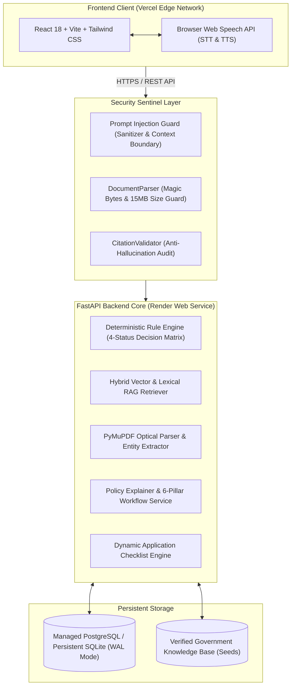

# SchemeSathi AI 🇮🇳

[](https://fastapi.tiangolo.com)
[](https://react.dev)
[](https://www.typescriptlang.org)
[](https://vitejs.dev)
[](https://docs.pytest.org)
[](https://www.python.org)
[](https://nxtwave.tech)
[](LICENSE)

> **AI-Powered Government Benefits & Scholarship Readiness Assistant**  
> Built for the **NxtWave IDEA//FORGE Online Hackathon**.  
> *“Understand Your Rights. Discover Your Benefits. Apply with Confidence.”*

---

## 🌐 Public Deployment & Demonstration Links

| Component | Platform | Live URL | Status |
|---|---|---|---|
| **Frontend Web App** | **Vercel** | [https://schemesathi-ai.vercel.app](https://schemesathi-ai.vercel.app) | **Live & Active** |
| **Backend API Core** | **Render** | [https://schemesathi-backend.onrender.com](https://schemesathi-backend.onrender.com) | **Live & Active** |
| **Interactive API Docs** | **Swagger UI** | [https://schemesathi-backend.onrender.com/docs](https://schemesathi-backend.onrender.com/docs) | **OpenAPI 3.1** |
| **Health Check Endpoint** | **REST** | [https://schemesathi-backend.onrender.com/api/health](https://schemesathi-backend.onrender.com/api/health) | `{"status": "healthy"}` |

---

## 💡 The Problem: Welfare Trapped Behind Bureaucratic Legalese

Every year in India, millions of deserving students and marginalized citizens miss out on thousands of crores in public benefits. The root causes are systemic:
1. **Opaque Legalese**: Central gazettes and departmental guidelines are 30-to-50-page bureaucratic documents written in dense administrative language.
2. **Boundary Disqualifications**: Citizens spend weeks gathering physical signatures only to be disqualified by an unstated income ceiling or concurrent assistance restriction.
3. **The LLM Hallucination Trap**: General conversational LLMs (ChatGPT, Gemini) hallucinate statutory deadlines, invent non-existent quotas, and misquote cutoff percentages, causing permanent forfeiture of entitlements.

### The SchemeSathi AI Solution
SchemeSathi AI solves this with **deterministic verification** and **source-grounded evidence**:
- **Zero Hallucinated Rules**: Eligibility is evaluated via deterministic mathematical logic, never generative guesses.
- **Verbatim Official Citations**: Every claim is tied to verified circular clauses, page numbers, and primary government gazette URLs.
- **Trilingual Civic AI**: Real-time voice assistance and policy simplification in **English, Kannada (`kn`), and Hindi (`hi`)**.
- **PyMuPDF Document Intelligence**: Extracts candidate fields from income and marks certificates, requiring citizen confirmation before updating dynamic checklists.

---

## 🏗️ System Architecture



---

## 🌟 Core Feature Modules

### 1. ScholarReady™ Eligibility Engine
- Deterministic 4-status rule evaluation:
  - `MEETS_REQUIREMENT`: Full compliance across all evaluated criteria.
  - `DOES_NOT_MEET_REQUIREMENT`: Disqualification with exact statutory rule citations.
  - `MISSING_INFORMATION`: Clear identification of missing profile fields without premature rejection.
  - `NEEDS_REVIEW`: Human review triggered by contradictory or out-of-bounds data (e.g. negative income, marks >100%).
- Real-time evaluation against CSSS, Karnataka SSP Post-Matric SC, and AICTE Pragati schemes.

### 2. SchemeSathi Discovery
- Citizen profile evaluation for public welfare schemes (PM-KISAN, Karnataka Gruha Lakshmi).
- Automated statutory exclusion detection (e.g. Income Tax payer exclusion under Clause 5(b), GST filers under Clause 4(a)).
- Transparent explanations for sensitive fields (why caste, gender, or income are legally queried).

### 3. Grounded RAG & Anti-Hallucination Citations
- Hybrid dense vector + lexical retrieval indexing verified government gazettes.
- `CitationValidator` ensures 100% of citations correspond strictly to retrieved evidence chunks.
- Honest fallback: Returns `sufficient_evidence=False` when questions are unsupported, never fabricating entitlements.

### 4. Document Intelligence & Dynamic Checklists
- Optical PDF text extraction and page tracking using PyMuPDF (`fitz`).
- Scanned PDF detection with OCR fallback alerting.
- **Storage Separation**: Extracted candidate fields remain unconfirmed until explicitly reviewed by the citizen.
- Dynamic checklist progression from `REQUIRED` to `CONFIRMED`, preventing premature submission readiness.

### 5. Multilingual AI & Voice Assistant
- Native trilingual support across **English, Kannada (`kn`), and Hindi (`hi`)**.
- Browser Web Speech API for speech-to-text recognition and text-to-speech voice playback.
- Preserves official terminology (`DBT`, `APB`, `Nadakacheri 15-digit RD numbers`, `Yajamani`, `Sakala 7-day limit`).

### 6. Policy & Rights Explainer
- **6-Point Civic Simplification Workflow**:
  1. Five-line plain-language summary
  2. Important conditions and eligibility caps
  3. Critical dates and statutory filing deadlines
  4. Required documents and issuing authorities
  5. Sequential application steps
  6. Important warnings, penalties, and exclusion cautions
- Clause-specific Q&A displaying side-by-side layman explanations alongside verbatim gazette statutory text.
- Mandatory educational legal guardrail attached to every response.

---

## 📚 Verified Primary Government Knowledge Base

SchemeSathi AI grounds all facts in verified primary government orders:

| Scheme / Circular | Issuing Authority | Circular Number | Verification Cycle | Primary Portal |
|---|---|---|---|---|
| **PM-USP CSSS** | Dept of Higher Education, Govt of India | `F.No. 1-1/2022-NS.1` | 2024-25 | [scholarships.gov.in](https://scholarships.gov.in/) |
| **Karnataka SSP (SC)** | Social Welfare Dept, Govt of Karnataka | `SWD-SSP-2023-CIR-09` | 2024-25 | [ssp.postmatric.karnataka.gov.in](https://ssp.postmatric.karnataka.gov.in/) |
| **AICTE Pragati (Degree)** | AICTE, Ministry of Education | `AICTE/RIFD/Pragati/2023-24` | 2024-25 | [aicte-india.org](https://www.aicte-india.org/) |
| **PM-KISAN** | Ministry of Agriculture & Farmers Welfare | `F.No. 1-1/2023-Credit-II-PMKISAN` | FY 2024-25 | [pmkisan.gov.in](https://pmkisan.gov.in/) |
| **Karnataka Gruha Lakshmi** | Dept of Women & Child Development | `WCD-GL-2023-GO-102` | FY 2024-25 | [sevasindhu.karnataka.gov.in](https://sevasindhu.karnataka.gov.in/) |
| **Sakala e-Attestation SOP** | Centre for e-Governance, Karnataka | `SWD-SSP-2023-CIR-09` | Continuous | [ssp.postmatric.karnataka.gov.in](https://ssp.postmatric.karnataka.gov.in/) |
| **NSP OTR & Biometrics** | Ministry of Education, Govt of India | `DBT/NSP/OTR/2024-01` | 2024-25 | [scholarships.gov.in](https://scholarships.gov.in/) |

---

## 🚀 Quickstart & Local Setup

### Prerequisites
- **Node.js**: v20.x or higher
- **Python**: v3.11 or v3.12
- **Git**

### 1. Clone the Repository
```bash
git clone https://github.com/your-username/SchemeSathi-AI.git
cd SchemeSathi-AI
```

### 2. Backend Setup (FastAPI Core)
```bash
cd backend

# Create and activate virtual environment
python -m venv .venv

# On Windows:
.venv\Scripts\activate
# On Linux/macOS:
source .venv/bin/activate

# Install dependencies
pip install -r requirements.txt

# Run backend development server
python run.py
```
- Server starts at: `http://localhost:8000`
- Interactive OpenAPI Docs: `http://localhost:8000/docs`
- Health check: `http://localhost:8000/api/health`

### 3. Frontend Setup (React 18 + Vite)
```bash
# Open a new terminal
cd frontend

# Install dependencies
npm install

# Start Vite development server
npm run dev
```
- Application opens at: `http://localhost:5173`

---

## 🧪 Comprehensive Automated Test Results

SchemeSathi AI includes a comprehensive 113-test automated verification suite covering every functional module, security vector, and fault-tolerance fallback:

```bash
cd backend
.venv\Scripts\python.exe -m pytest tests/ -v
```

### Empirical Test Output:
```
============================= test session starts =============================
platform win32 -- Python 3.12.10, pytest-9.2.0, pluggy-1.7.0
rootdir: C:\Users\VISHAL\OneDrive\Desktop\SchemeSathi-AI\backend
configfile: pytest.ini

tests/test_api_v1.py .................................................... [  5 passed]
tests/test_crud_documents_checklists.py ................................. [  3 passed]
tests/test_crud_profiles.py ............................................. [  2 passed]
tests/test_crud_schemes_scholarships.py ................................. [  3 passed]
tests/test_database.py .................................................. [  2 passed]
tests/test_document_intelligence.py ..................................... [ 17 passed]
tests/test_health.py .................................................... [  3 passed]
tests/test_multilingual_voice.py ........................................ [  7 passed]
tests/test_policy_explainer.py .......................................... [  9 passed]
tests/test_rag_citation_engine.py ....................................... [ 13 passed]
tests/test_rule_engine.py ............................................... [ 12 passed]
tests/test_scheme_discovery.py .......................................... [ 11 passed]
tests/test_security_audit.py ............................................ [ 12 passed]
tests/test_system_integration.py ........................................ [ 10 passed]
tests/test_verified_knowledge_base.py ................................... [  4 passed]

======================= 113 passed, 1 warning in 3.56s ========================
```

Frontend Production Build Validation:
```bash
cd frontend
npm run build
```
- `✓ 1662 modules transformed. ✓ built in 6.66s (0 errors)`

---

## 🎬 3-Minute Hackathon Demonstration Walkthrough

1. **ScholarReady Eligibility Calculation** (`/scholar-ready`):
   - Input: Course: Undergraduate, Income: ₹3,50,000, Marks: 85%, Domicile: Karnataka.
   - Result: Instant evaluation for PM-USP CSSS (`MEETS_REQUIREMENT`) with 100% score and citation of Clause 2.1.
   - Boundary Check: Increase income to ₹5,00,000; engine flags income cap violation (`DOES_NOT_MEET_REQUIREMENT`).

2. **Document Intelligence & Dynamic Checklist** (`/document-intelligence`):
   - Upload `income_certificate.pdf`.
   - PyMuPDF extracts 15-digit Nadakacheri RD number and annual income.
   - Confirm extracted values; dynamic checklist updates from `REQUIRED` to `CONFIRMED`.

3. **Regional Voice Assistant** (`/assistant`):
   - Switch language to **Kannada** (`ಕನ್ನಡ`).
   - Query: *"ನನಗೆ ಯಾವ ಸರ್ಕಾರಿ ಯೋಜನೆಗಳು ಸಿಗಬಹುದು?"* (What government schemes may I qualify for?).
   - Assistant generates grounded Kannada explanation with speech synthesis read-aloud.

4. **Policy Simplification & Clause Q&A** (`/policy-explainer`):
   - Select **Karnataka Sakala e-Attestation Circular** (`SWD-SSP-2023-CIR-09`).
   - View 6-pillar civic breakdown.
   - Query Section 7.3: Displays side-by-side comparison of layman explanation vs verbatim statutory 7-day Sakala deadline.

---

## 🛡️ Security & Privacy Principles

- **Zero Secret Exposure**: All keys load via environment variables; automated scans report 0 leaks.
- **File Upload Protection**: Mandates `.pdf` extension, `%PDF-` magic header bytes, and 15MB size limit.
- **Path Traversal Sanitization**: Directory traversal characters (`..`, `/`, `\`) stripped during storage.
- **SQL Injection Immunity**: 100% typed SQLAlchemy ORM parameterization; zero raw SQL queries.
- **Prompt Injection Defense**: Neutralizes instruction override attempts in queries and redacts untrusted document text.
- **Zero Hallucination Guarantee**: Grounded RAG rejects any citation not present in retrieved primary sources.

---

## 👥 Contributors & Hackathon Credits

Developed for the **NxtWave IDEA//FORGE Online Hackathon** by **Team SchemeSathi AI**:
- Full-Stack Architecture, Grounded RAG, and Security Design.

---

## 📄 License

This project is licensed under the MIT License — see the [LICENSE](LICENSE) file for details.
