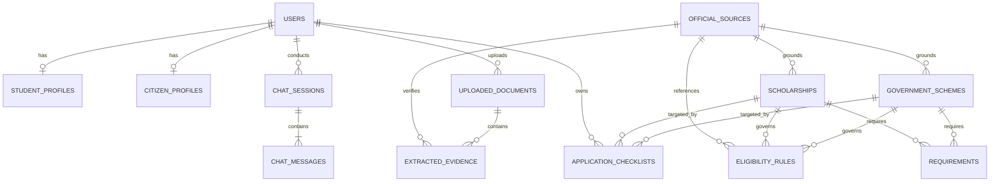

# SchemeSathi AI — Database Architecture & Entity Design

This document details the database architecture and entity relationship specifications implemented in Phase 3 for **SchemeSathi AI**.

---

## 1. Architectural Principles

1. **Deterministic & Auditable**: Every eligibility condition is stored as structured criteria (`structured_condition`) with direct foreign-key traceability to an `OfficialSource`.
2. **Zero Hallucination Grounding**: Schemes and rules reference official gazette circular numbers, verification dates, and exact clause citations (`Section X Clause Y`).
3. **Database Portability**: Built with SQLAlchemy 2.0 and Pydantic v2. Runs on SQLite with WAL (Write-Ahead Logging) mode enabled for concurrency in local development, and seamlessly migrates to PostgreSQL for production.
4. **Clean Decoupling**: Repositories isolate all ORM logic; Services encapsulate domain workflows; Routers handle HTTP protocol concerns.

---

## 2. Entity-Relationship Diagram

---

## 3. Core Entity Specifications

### 1. `users`
Represents an authenticated citizen, student, or administrative user.
- `id` (PK, String 36, UUID)
- `email` (String 255, Unique, Nullable)
- `phone_number` (String 20, Unique, Nullable)
- `full_name` (String 255)
- `role` (String 50: `CITIZEN`, `STUDENT`, `ADMIN`)
- `is_active` (Boolean)
- `created_at`, `updated_at` (Timestamps with timezone)

### 2. `student_profiles` (ScholarReady)
Captures academic and socio-economic markers for deterministic scholarship matching.
- `id` (PK, String 36)
- `user_id` (FK -> `users.id`, Unique, Nullable)
- `full_name` (String 255)
- `domicile_state` (String 100)
- `category` (String 50: `General`, `OBC`, `SC`, `ST`, `EWS`, `Minority`)
- `annual_family_income` (Float, INR)
- `current_course` (String 150)
- `year_of_study` (String 50)
- `marks_percentage` (Float 0-100)
- `gender` (String 50)
- `disability_status` (Boolean)
- `hosteller_status` (String 50: `Day Scholar`, `Hosteller`)
- `extra_attributes` (JSON: extensible indicators e.g. `rural_student`, `kannada_medium`)

### 3. `citizen_profiles` (SchemeSathi)
Captures citizen demographic, occupational, and vulnerability markers.
- `id` (PK, String 36)
- `user_id` (FK -> `users.id`, Unique, Nullable)
- `full_name` (String 255)
- `age` (Integer)
- `gender` (String 50)
- `domicile_state` (String 100)
- `district` (String 100)
- `area_type` (String 50: `Rural`, `Urban`)
- `occupation` (String 100: `Farmer`, `Artisan`, `Daily Wage`, etc.)
- `annual_family_income` (Float, INR)
- `social_category` (String 50)
- `landholding_hectares` (Float)
- `is_income_tax_payer` (Boolean)
- `is_differently_abled` (Boolean)
- `bpl_card_holder` (Boolean)
- `extra_attributes` (JSON)

### 4. `official_sources`
Stores verified government circulars, gazettes, and official orders for legal traceability.
- `id` (PK, String 50)
- `source_title` (String 255)
- `issuing_authority` (String 255)
- `circular_number` (String 100, Indexed)
- `notification_date` (Date)
- `official_url` (String 500)
- `document_checksum` (String 64, SHA-256 for audit integrity)
- `file_path` (String 500)
- `notes` (Text)

### 5. `scholarships`
Verified academic scholarships registry for ScholarReady.
- `id` (PK, String 50)
- `official_name` (String 255)
- `category` (String 100: default `Education & Scholarships`)
- `description` (Text)
- `government_department` (String 255)
- `official_source_url` (String 500)
- `application_url` (String 500)
- `academic_cycle` (String 50, e.g. `2025-26`)
- `verification_date` (Date)
- `publication_date` (Date)
- `information_status` (String 50: `VERIFIED`, `DRAFT`, `ARCHIVED`, `NEEDS_UPDATE`)
- `level` (String 100: `National / Central`, `State Gov`, `Institutional / Merit`)
- `course_level` (String 100: `Pre-Matric`, `Post-Matric`, `Undergraduate`, etc.)
- `max_annual_income` (Float, INR)
- `min_percentage` (Float, 0-100)
- `eligible_categories` (JSON: `['SC', 'ST', 'OBC', 'General', 'EWS', 'Minority']`)
- `benefit_amount_annual` (String 150)
- `application_deadline` (String 100)
- `official_source_id` (FK -> `official_sources.id`)

### 6. `government_schemes`
Verified civic welfare schemes and subsidies for SchemeSathi.
- `id` (PK, String 50)
- `official_name` (String 255)
- `category` (String 100: `Agriculture & Farming`, `Healthcare`, `Housing`, `MSME`, etc.)
- `description` (Text)
- `government_department` (String 255)
- `official_source_url` (String 500)
- `application_url` (String 500)
- `policy_cycle` (String 100, e.g. `Continuous (FY 2025-26)`)
- `verification_date` (Date)
- `publication_date` (Date)
- `information_status` (String 50: `VERIFIED`, `DRAFT`, `ARCHIVED`, `NEEDS_UPDATE`)
- `level` (String 100: `Central`, `State (Karnataka)`, etc.)
- `benefit_type` (String 100: `Direct Benefit Transfer (DBT)`, `Subsidy`, `Health Insurance Cover`)
- `annual_benefit` (String 255)
- `target_beneficiaries` (String 255)
- `application_deadline` (String 100)
- `official_source_id` (FK -> `official_sources.id`)

### 7. `eligibility_rules`
Deterministic condition units parsed from government orders.
- `id` (PK, String 50)
- `requirement_description` (String 500)
- `rule_type` (String 100: `INCOME_CAP`, `CASTE_CRITERION`, `DOMICILE`, `MARKS`, `AGE`, `EXCLUSION`)
- `structured_condition` (JSON: `{"field": "...", "operator": "LTE|GTE|EQ|IN", "value": ...}`)
- `source_id` (FK -> `official_sources.id`)
- `page_number` (String 50)
- `clause_or_section` (String 150, e.g. `Section 4.1 Clause (b)`)
- `applicable_cycle` (String 50)
- `scholarship_id` (FK -> `scholarships.id`, Nullable)
- `scheme_id` (FK -> `government_schemes.id`, Nullable)
- `is_mandatory` (Boolean)
- `failure_guidance` (Text)

### 8. `requirements`
Official document checklist requirements linked to schemes or scholarships.
- `id` (PK, String 50)
- `scholarship_id` (FK -> `scholarships.id`, Nullable)
- `scheme_id` (FK -> `government_schemes.id`, Nullable)
- `document_type` (String 100: `INCOME_CERT`, `CASTE_CERT`, `BONAFIDE`, `PASSBOOK`, `LAND_RECORD`)
- `title` (String 255)
- `description` (Text)
- `issuing_authority` (String 255)
- `is_mandatory` (Boolean)
- `verification_criteria` (JSON)

### 9. `uploaded_documents`
User-uploaded supporting documents awaiting metadata extraction.
- `id` (PK, String 50)
- `user_id` (FK -> `users.id`, Nullable)
- `student_profile_id` (FK -> `student_profiles.id`, Nullable)
- `citizen_profile_id` (FK -> `citizen_profiles.id`, Nullable)
- `document_type` (String 100)
- `original_filename` (String 255)
- `storage_path` (String 500)
- `file_size_bytes` (Integer)
- `mime_type` (String 100)
- `sha256_hash` (String 64)
- `processing_status` (String 50: `PENDING`, `PROCESSED`, `FAILED`)

### 10. `extracted_evidence`
Atomic factual items parsed from user documents via PyMuPDF.
- `id` (PK, String 50)
- `document_id` (FK -> `uploaded_documents.id`)
- `official_source_id` (FK -> `official_sources.id`, Nullable)
- `evidence_type` (String 100: `CERT_NUMBER`, `ISSUE_DATE`, `BENEFICIARY_NAME`, `ANNUAL_INCOME`)
- `extracted_value` (String 500)
- `confidence_score` (Float 0.0 - 1.0)
- `page_number` (Integer)
- `bounding_box` (JSON)
- `raw_text_snippet` (Text)

### 11. `application_checklists`
Personalized preparation checklists evaluating readiness before submission.
- `id` (PK, String 50)
- `user_id` (FK -> `users.id`, Nullable)
- `student_profile_id` (FK -> `student_profiles.id`, Nullable)
- `citizen_profile_id` (FK -> `citizen_profiles.id`, Nullable)
- `scholarship_id` (FK -> `scholarships.id`, Nullable)
- `scheme_id` (FK -> `government_schemes.id`, Nullable)
- `readiness_score` (Float 0.0 - 100.0%)
- `overall_status` (String 50: `NOT_STARTED`, `IN_PROGRESS`, `READY`, `ACTION_REQUIRED`)
- `checklist_items` (JSON array of items with `ready`, `expiring`, `missing` status)
- `evaluated_at` (Timestamp)

### 12. `chat_sessions` & `chat_messages`
Multilingual conversational advisory grounded with verifiable citations.
- **`chat_sessions`**:
  - `id` (PK, String 50)
  - `user_id` (FK -> `users.id`, Nullable)
  - `title` (String 255)
  - `language` (String 10: `en`, `kn`, `hi`, `te`, `ta`, `mr`)
  - `context_metadata` (JSON)
- **`chat_messages`**:
  - `id` (PK, String 50)
  - `session_id` (FK -> `chat_sessions.id`)
  - `sender` (String 20: `user`, `assistant`)
  - `content` (Text)
  - `language` (String 10)
  - `citations` (JSON list of verified official source excerpts)
  - `suggested_follow_ups` (JSON)
