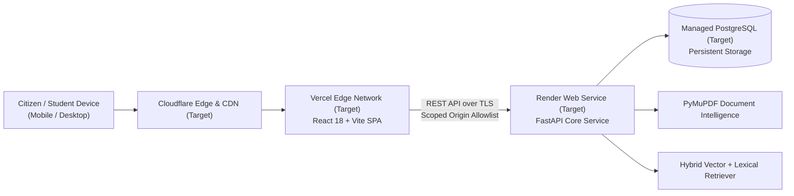

# SchemeSathi AI — Hackathon Pitch & 3-Minute Demo Script

**Event**: NxtWave IDEA//FORGE Online Hackathon  
**Track**: AI-Powered Civic Tech & Public Information Systems  
**Product**: SchemeSathi AI (ScholarReady & SchemeSathi Intelligence Suite)  

---

## 1. Project Pitch & Executive Value Proposition

### The Problem
Every year, hundreds of thousands of underprivileged Indian students and citizens miss out on thousands of crores in government scholarships and Direct Benefit Transfer (DBT) welfare schemes. The primary failure points are:
1. **Opaque, dense bureaucratic legalese**: 40-page gazette circulars with confusing clauses.
2. **Disqualification by missing criteria**: Citizens spend weeks in administrative queues only to discover an income cap or statutory exclusion rule.
3. **The AI Hallucination Hazard**: Mainstream conversational LLMs frequently fabricate scheme rules, invent nonexistent benefits, and provide outdated deadlines, leading to permanent disqualification.

### The Solution: SchemeSathi AI
SchemeSathi AI is an assistive civic-intelligence platform designed to give citizens and students crystal-clear, verified guidance. Built on a dual-engine architecture:
- **ScholarReady**: Personalized scholarship readiness for undergraduate and post-matric students, pairing a deterministic 4-status rule evaluation engine (`MEETS_REQUIREMENT`, `DOES_NOT_MEET_REQUIREMENT`, `MISSING_INFORMATION`, `NEEDS_REVIEW`) with PyMuPDF document intelligence and dynamic document checklists.
- **SchemeSathi Policy & Rights Explainer**: Grounded Retrieval-Augmented Generation (RAG) and policy simplification in **English, Kannada, and Hindi**, backed by verified primary gazette circulars, verbatim legal excerpts, and zero-hallucination citation guarantees.

### Key Differentiators
- **Deterministic Truth Over Speculative Generation**: We use mathematical rule evaluations for income limits, percentages, and domiciles.
- **Strict Evidence Boundaries**: Every claim links to an official gazette clause, circular number, and verified government portal URL.
- **Privacy by Default**: Citizen income, marks, and personal documents are parsed locally and verified with explicit consent.

---

## 2. Three-Minute Live Demonstration Script

```mermaid
flowchart TD
    Step1["1. Landing & Civic Orientation (0:00 - 0:30)
• Hero banner & civic mission orientation
• Trilingual selector (English, Kannada, Hindi)
• Select ScholarReady or SchemeSathi entry point"]
    Step2["2. ScholarReady Profile Intake (0:30 - 0:50)
• Input student course, family income (₹3,50,000), marks (85%), domicile
• Privacy-first: no unnecessary personal identifiable data requested"]
    Step3["3. Deterministic Rule Evaluation (0:50 - 1:10)
• Mathematical rule evaluation against primary gazette circulars
• CSSS evaluated as MEETS_REQUIREMENT (100% match score)
• Boundary condition: ₹5,00,000 income flags exact disqualification"]
    Step4["4. Document Intelligence Parsing (1:10 - 1:30)
• Upload income_certificate.pdf (PyMuPDF optical extraction)
• Extract 15-digit RD number, assessed income, and issuing authority
• Page-level citation indicator for user verification"]
    Step5["5. Evidence Confirmation & Checklist (1:30 - 1:45)
• Citizen reviews and confirms candidate extracted values
• Strict anti-hallucination guard: extraction != legal authenticity
• Dynamic checklist automatically updates from REQUIRED to CONFIRMED"]
    Step6["6. Regional Voice & Scheme Discovery (1:45 - 2:20)
• Switch interface and voice to Kannada ('ನನಗೆ ಯಾವ ಸರ್ಕಾರಿ ಯೋಜನೆಗಳು ಸಿಗಬಹುದು?')
• Browser Web Speech API capture (STT) and synthesized speech playback (TTS)
• Grounded regional explanation citing Gruha Lakshmi & PM-KISAN"]
    Step7["7. Policy & Rights Explainer (2:20 - 3:00)
• Karnataka Sakala e-Attestation circular: 6-point civic breakdown
• Highlight Section 7.3: 7-day statutory attestation deadline
• Wrap-up: 113 automated tests passed and security audit overview"]

    Step1 --> Step2
    Step2 --> Step3
    Step3 --> Step4
    Step4 --> Step5
    Step5 --> Step6
    Step6 --> Step7
```

| Timing | Page / Screen | Presenter Action | Spoken Script / Narration | Key Visual Highlight |
|---|---|---|---|---|
| **0:00 - 0:30** | **Landing Page** (`/`) | Scroll through Hero banner and show the dual ScholarReady & SchemeSathi modules. Click **"Explore Schemes"** or **"Check Scholarship Readiness"**. | *"Respected judges, meet SchemeSathi AI. In India, public welfare shouldn't require a law degree. We provide deterministic, verified guidance so citizens and students understand their rights and apply with confidence."* | Modern civic-tech aesthetic, verified data badges, trilingual selector. |
| **0:30 - 1:10** | **ScholarReady Engine** (`/scholar-ready`) | 1. Enter student profile: Course: Undergraduate, Income: ₹3,50,000, Marks: 85%, State: Karnataka. 2. Click **"Evaluate Readiness"**. 3. Show CSSS evaluated as `MEETS_REQUIREMENT`. 4. Change income to ₹5,00,000 to show instant boundary disqualification under Rule `RULE-CSSS-INCOME`. | *"Let's test ScholarReady. When Kavita inputs her marks and family income, our engine does NOT guess. It evaluates against primary statutory gazettes. At ₹3.5 Lakhs, she meets the Central Sector Scheme criteria with an exact citation. If her income was ₹5 Lakhs, it cleanly identifies the boundary violation."* | Deterministic evaluation card, 100% match score, verified citation card. |
| **1:10 - 1:45** | **Document Intelligence & Dynamic Checklist** (`/document-intelligence`) | 1. Navigate to Document Intelligence. 2. Upload `income_certificate.pdf`. 3. PyMuPDF extracts name, RD number, income, and Tahsildar authority. 4. Click **"Confirm Extracted Values"**. 5. Show Dynamic Checklist progress from `REQUIRED` to `CONFIRMED`. | *"Students struggle with documentation. SchemeSathi uses optical document intelligence. When Kavita uploads her revenue certificate, it extracts her 15-digit RD number and assessed income. Crucially, it asks for confirmation before updating her checklist—never assuming text extraction equals legal authenticity."* | Extracted candidate values, source page indicator, dynamic checklist progress bar. |
| **1:45 - 2:20** | **Scheme Discovery & Trilingual Voice Assistant** (`/assistant`) | 1. Switch active language to **Kannada** (`ಕನ್ನಡ`). 2. Click voice demonstration button: *"ನನಗೆ ಯಾವ ಸರ್ಕಾರಿ ಯೋಜನೆಗಳು ಸಿಗಬಹುದು?"* (What government schemes may I qualify for?). 3. Assistant responds with Kannada explanation citing Gruha Lakshmi and PM-KISAN, and plays audio via speech synthesis. | *"Accessibility is regional. In Karnataka, a citizen asks in Kannada: 'ನನಗೆ ಯಾವ ಸರ್ಕಾರಿ ಯೋಜನೆಗಳು ಸಿಗಬಹುದು?' SchemeSathi answers in Kannada while strictly preserving official scheme names and legal clauses—speaking the answer aloud for rural accessibility."* | Sound wave visualizer, Kannada text and voice synthesis, source citations. |
| **2:20 - 2:50** | **Policy Explainer** (`/policy-explainer`) | 1. Select **Karnataka Sakala e-Attestation SOP** (`SWD-SSP-2023-CIR-09`). 2. Show the **6-Point Civic Simplification Workflow** (5-line summary, statutory deadlines, required documents). 3. Ask: *"What is the time limit under Section 7.3?"* 4. Show side-by-side comparison: plain-language explanation vs verbatim gazette legal clause with 7-day Sakala deadline. | *"Finally, our Policy Explainer translates 20-page circulars into a 6-pillar civic breakdown. Under Section 7.3, citizens see that college officers are legally required by the Sakala Act to attest documents within 7 working days, with a verbatim gazette clause citation."* | 5-line summary cards, 7-day Sakala deadline badge, verbatim legal text comparison. |
| **2:50 - 3:00** | **Conclusion** | Show test metrics: 113 automated tests passed (100%), 0 security vulnerabilities. | *"With 113 verified automated tests, zero hallucinated citations, and full trilingual voice support, SchemeSathi AI is ready to empower millions of Indian citizens. Thank you!"* | Testing suite summary, clean build badges. |

---

## 3. Verified Primary Government Data Sources

SchemeSathi AI relies strictly on primary central and state government repositories:

| Source Identifier | Official Scheme / Guideline Title | Department / Issuing Authority | Primary Source Portal |
|---|---|---|---|
| `SRC-MOE-PMUSP-CSSS` | Central Sector Scheme of Scholarship for College and University Students | Department of Higher Education, Ministry of Education, Govt of India | [scholarships.gov.in](https://scholarships.gov.in/) |
| `SRC-MOSJE-SSP-SC` | Post-Matric Scholarship Scheme for SC Students | Social Welfare Department, Govt of Karnataka | [ssp.postmatric.karnataka.gov.in](https://ssp.postmatric.karnataka.gov.in/) |
| `SRC-AICTE-PRAGATI` | AICTE Pragati Scholarship for Girl Students (Degree) | All India Council for Technical Education, Govt of India | [aicte-india.org](https://www.aicte-india.org/) |
| `SRC-MOA-PMKISAN` | Pradhan Mantri Kisan Samman Nidhi (PM-KISAN) | Ministry of Agriculture and Farmers Welfare, Govt of India | [pmkisan.gov.in](https://pmkisan.gov.in/) |
| `SRC-KRN-DWCD-GL` | Karnataka Gruha Lakshmi Direct Income Support Scheme | Department of Women and Child Development, Karnataka | [sevasindhu.karnataka.gov.in](https://sevasindhu.karnataka.gov.in/) |
| `SRC-KRN-SSP-EATTEST` | Standard Operating Procedure for e-Attestation (Sakala Guarantee) | Centre for e-Governance & Social Welfare Department, Karnataka | [ssp.postmatric.karnataka.gov.in](https://ssp.postmatric.karnataka.gov.in/) |

---

## 4. Production Deployment Readiness

> **Deployment Status**: Deployment configuration prepared. Automated tests and local production builds reported successful. Vercel and Render deployment, live integration testing and production verification remain pending.

- **Frontend Target (Vercel)**: Deployment configuration prepared in `frontend/vercel.json` with SPA rewrite rules (`/(.*)` -> `/index.html`), caching headers, and modern security headers (without obsolete `X-XSS-Protection`). Local production build verified (`npm run build` compiled 1,662 modules with 0 errors).
- **Backend Target (Render)**: Containerization and Blueprint prepared in `render.yaml` and `backend/Dockerfile` with Python 3.12 and FastAPI. Health check verified locally at `/api/health`. Test suite verified (113 of 113 tests passed).
- **Database Architecture**: Configured for Render Managed PostgreSQL (`schemesathi-postgres`) with connection pooling (`pool_size=10, max_overflow=20, pool_pre_ping=True`) and idempotent startup seeding. Local SQLite fallback verified. *(Note: Automated database backup and disaster recovery schedules must be established upon live hosting provisioning before production sign-off).*

---

## 5. Known Limitations & Future Roadmap

### Current Limitations
1. **OCR Scope**: Image-based scanned PDFs with severe handwritten cursive or low contrast require high-resolution scans for optimal field extraction.
2. **Knowledge Base Breadth**: Initial verified catalog contains 6 deep primary schemes/circulars (representative for higher education, farming, and domestic welfare).
3. **Voice Recognition Browser Support**: Web Speech API is natively supported in Chromium and Safari; fallback to text input is automatically provided for older browsers.

### Future Roadmap
- **Phase 13 (Pan-India State Expansion)**: Ingest all 28 states' scholarship portals (e.g. MahaDBT, UP Scholarship Portal, Medhabruti Odisha).
- **DigiLocker Integration**: Direct API integration with DigiLocker to auto-fetch Nadakacheri, CBSE, and State Board certificates with zero user uploads.
- **WhatsApp & Telegram Chatbot**: Headless integration using SchemeSathi's verified RAG engine to reach rural citizens without requiring internet browsers.
- **Automated Grievance Filing**: One-click Sakala and CPGRAMS grievance generation when college nodal officers violate statutory processing deadlines.
