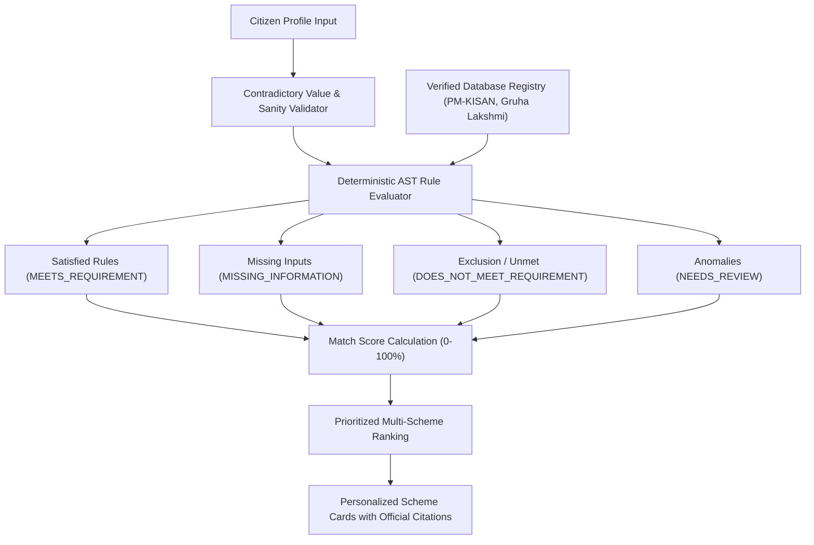

# SchemeSathi AI — Phase 6: Government Scheme Discovery Report

## Executive Summary

Phase 6 implements the personalized **Government Scheme Discovery** engine for the **SchemeSathi** module. SchemeSathi enables Indian citizens to discover central and state government entitlements tailored to their domicile, occupation, income, and household profile using a deterministic rule engine grounded in verified government notifications.

In compliance with project directives:
1. **Never use an LLM as the eligibility decision-maker**: Eligibility is computed entirely via pure Python deterministic evaluation (`DeterministicRuleEngine`).
2. **Offline Resilience**: The discovery and recommendation engine operates deterministically with structured database queries and AST evaluations even if AI providers are unreachable.
3. **Sensitive Data Minimization & Transparency**: Questions regarding sensitive status (such as income tax payment, landholding, and ration cards) are asked strictly when a verified statutory condition mandates them. Clear legal rationales and official clause citations are surfaced to the citizen.
4. **Official Source Traceability**: Every match, unmet rule, and required document is backed by authoritative source citations and direct application portal links.

---

## 1. Profile Field Specifications & Sensitive Data Transparency

Citizens provide the following profile attributes to evaluate schemes:

| Field | Type | Description | Mandatory / Optional | Statutory Justification |
| :--- | :--- | :--- | :--- | :--- |
| `domicile_state` | String | State of permanent residence (e.g. Karnataka, UP) | Core Field | Jurisdictional eligibility for state schemes (e.g. Gruha Lakshmi). |
| `district` | String | District of residence (e.g. Belagavi, Mandya) | Core Field | District-level welfare routing. |
| `age` | Integer | Completed age in years | Core Field | Age-based entitlements and verification. |
| `occupation` | String | Farmer, Homemaker, Daily Wage, MSME, Student | Core Field | Welfare category mapping. |
| `annual_family_income` | Float | Gross family income in INR | Core Field | Means-tested welfare and exclusion ceilings. |
| `area_type` | String | Rural or Urban | Core Field | Rural development and urban welfare targeting. |
| `gender` | String | Female, Male, Other | Core Field | Women empowerment schemes (e.g. Gruha Lakshmi Yajamani). |
| `landholding_hectares` | Float | Cultivable agricultural land in hectares | Sensitive / Optional | **PM-KISAN Clause 3.1**: Farmland title registered in state revenue portals (e.g. Bhoomi) is mandatory. |
| `is_income_tax_payer` | Boolean | Whether applicant or spouse filed/paid Income Tax | Sensitive / Optional | **PM-KISAN Clause 5(b)(vi) & Gruha Lakshmi Clause 4**: Legally excludes income tax assessees and GST filers. |
| `bpl_card_holder` | Boolean | Possession of Antyodaya, BPL, or APL ration card | Sensitive / Optional | **Gruha Lakshmi Clauses 2 & 3**: Financial assistance is tied to the designated family head (Yajamani) on state ration cards. |

### Sensitive Data Transparency Endpoint
- `GET /api/v1/eligibility/sensitive-fields`
Returns structured explanations citing the exact clauses why each sensitive question is collected.

---

## 2. Deterministic Rule Engine Architecture

The `DeterministicRuleEngine` evaluates government schemes without probabilistic hallucination.

### Evaluation Outcomes:
1. `MEETS_REQUIREMENT`: The citizen's submitted attributes fully satisfy the statutory condition.
2. `DOES_NOT_MEET_REQUIREMENT`: The citizen fails an essential mandatory criterion (e.g. paying income tax excludes from PM-KISAN, or male gender for Gruha Lakshmi).
3. `MISSING_INFORMATION`: An essential field required by the scheme has not been provided (never assumed or guessed).
4. `NEEDS_REVIEW`: The citizen provided contradictory or out-of-bounds data (e.g., negative landholding or negative income).

### Ranking Logic:
Schemes are sorted deterministically in four prioritized tiers:
1. `MEETS_REQUIREMENT` (Priority 0) — Sorted by match score descending.
2. `MISSING_INFORMATION` (Priority 1) — Sorted by match score descending.
3. `NEEDS_REVIEW` (Priority 2) — Sorted by match score descending.
4. `DOES_NOT_MEET_REQUIREMENT` (Priority 3) — Ranked at the bottom with explicit exclusion reasons.

---

## 3. Scheme Card Components

Each scheme card in the frontend and API responses provides:

1. **Official Scheme Title**: e.g. *Pradhan Mantri Kisan Samman Nidhi (PM-KISAN)*.
2. **Department & Government Level**: e.g. *Department of Agriculture and Farmers Welfare, GoI (Central)*.
3. **Category Badge**: e.g. *Agriculture & Farming*, *Social Security & Pensions*.
4. **Benefit Amount & Delivery Channel**: e.g. *₹6,000 / year via Direct Benefit Transfer (DBT)*.
5. **Eligibility Assessment Badge**: Color-coded indicator (`Eligible 100%`, `Needs Info`, `Not Eligible`, `Needs Review`).
6. **Important Conditions**: Key statutory prerequisites extracted from official orders.
7. **Required Verification Documents**: List of mandatory certificates with issuing authorities (e.g. ROR/Patta, Ration Card, Aadhaar).
8. **Official Source Reference**: Source title, circular number (e.g., *1-1/2019-Credit-II*), and link to authoritative gazette.
9. **Official Application Portal Link**: Verified direct government registration URL (e.g., *pmkisan.gov.in*).
10. **Verification Date**: Date when operational guidelines were audited (*2024-11-01*).

---

## 4. API Endpoints

| Method | Endpoint | Description |
| :--- | :--- | :--- |
| `GET` | `/api/v1/eligibility/sensitive-fields` | Returns civic rationales and legal citations for sensitive profile questions. |
| `POST` | `/api/v1/eligibility/evaluate-scheme/{scheme_id}` | Evaluates a single scheme against a citizen profile. |
| `POST` | `/api/v1/eligibility/discover-schemes` | Evaluates all active schemes matching filters (category, level, search) and ranks results. |
| `GET` | `/api/v1/schemes` | Lists verified schemes with pagination and filtering. |

---

## 5. Verification & Automated Test Suite

A dedicated automated test suite (`backend/tests/test_scheme_discovery.py`) verifies all functional requirements:

1. `test_pm_kisan_eligible_farmer`: Landholding > 0, Income tax payer = False -> `MEETS_REQUIREMENT`, score = 100%.
2. `test_pm_kisan_tax_payer_exclusion`: Income tax payer = True -> `DOES_NOT_MEET_REQUIREMENT` with citation to Clause 5(b)(vi).
3. `test_pm_kisan_missing_landholding`: Missing landholding -> `MISSING_INFORMATION` (no guessing).
4. `test_pm_kisan_negative_landholding_needs_review`: Negative landholding -> `NEEDS_REVIEW`.
5. `test_gruha_lakshmi_eligible_woman_head`: Female, Karnataka, non-taxpayer -> `MEETS_REQUIREMENT`.
6. `test_gruha_lakshmi_disqualified_by_gender`: Male -> `DOES_NOT_MEET_REQUIREMENT`.
7. `test_gruha_lakshmi_disqualified_by_domicile`: Non-Karnataka resident -> `DOES_NOT_MEET_REQUIREMENT`.
8. `test_scheme_discovery_ranking`: Multi-scheme ranking prioritizes matching schemes ahead of excluded schemes.
9. `test_api_sensitive_fields_explanation`: API verifies transparency documentation for sensitive fields.
10. `test_api_evaluate_single_scheme`: End-to-end single scheme evaluation API.
11. `test_api_discover_schemes_with_filter`: Category-filtered multi-scheme discovery API.

### Test Results:
- **Backend automated test suite**: **45 passed / 45 total (100% pass rate)**.
- **Frontend build**: TypeScript and Vite production build passed with **0 errors and 0 warnings**.
